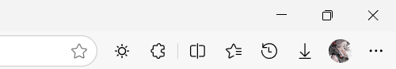
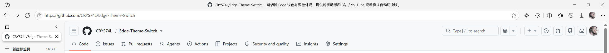
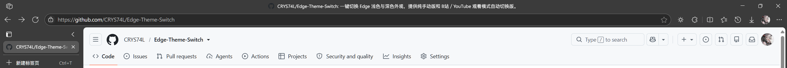

# Edge 外观一键切换

一个用于 Windows 版 Microsoft Edge 的外观一键切换扩展，提供纯手动版和视频观看时自动切换的版本。

切换范围包括浏览器顶栏、标签栏、工具栏和地址栏；网页内容与 Windows 系统主题保持原样。

安装后，点击右上角拼图形状的“扩展”按钮，找到“Edge 外观一键切换”并固定到工具栏。图中的太阳图标就是切换按钮，位于“扩展”按钮左侧：



**单击太阳图标，即可在浅色与灰阶深色外观之间一键切换。**

## 实际效果

同一网页下的浅色与深色外观实拍，截图裁取了顶栏、工具栏、垂直标签栏和页面顶部。

**浅色外观**



**一键切换后的深色外观**



## 下载与版本选择

前往 [Release 下载页](https://github.com/CRYS74L/Edge-Theme-Switch/releases/latest)，在 Assets 中选择一个 ZIP：

| 版本 | 适合谁 | 功能 |
| --- | --- | --- |
| 文件名以 `-auto.zip` 结尾 | 希望看视频时自动进入深色的用户 | 手动按钮 + B站／YouTube 自动切换 |
| 文件名以 `-manual.zip` 结尾 | 只想自己点击切换的用户 | 仅手动按钮，不申请网站访问权限 |

两个版本**二选一**。请下载上述 ZIP；GitHub 自动生成的 `Source code` 是项目源码，不是准备好的使用包。

## 解压后是什么

这是通过 Edge 开发人员模式加载的扩展包，**没有安装程序，也不需要双击 EXE**。解压后主要用到：

| 文件或文件夹 | 用途 |
| --- | --- |
| `安装说明.md` | 中文使用说明 |
| `packages/controller` | 在 Edge 中加载的扩展文件夹 |
| `packages/theme-dark.crx` | 需要拖入 Edge 安装的深色主题 |
| `scripts/install-theme-policy.ps1` | 首次安装时设置主题保留策略 |

将整个解压目录放在准备长期保留的位置。Edge 会直接读取其中的扩展文件，安装后不要删除或移动该目录。

## 首次安装

1. 在正在使用的 Edge 中打开 `edge://extensions`，开启“开发人员模式”。
2. 点击“加载解压缩的扩展”，选择解压目录中的 **`packages/controller` 文件夹**。不要选择整个解压目录，也不要选择 `src`。
3. 将 **`packages/theme-dark.crx`** 拖入同一个扩展页面，按提示安装深色主题。
4. 自动版如有网站权限提示，允许访问 B站和 YouTube。
5. 按下面的说明设置一次主题保留策略。
6. 按文首图示将扩展固定到工具栏，再点击太阳图标，确认可以来回切换深浅外观。

### 设置主题保留策略

已在 Edge 139 验证：处于停用状态的普通主题可能被浏览器自动移除。安装包提供一次性脚本，用于保留本扩展需要的深色主题；已经设置过的用户无需重复执行。

以管理员身份打开 PowerShell，先切换到解压目录，再执行脚本。下面的路径只是示例，请替换成你实际的解压位置：

```powershell
Set-Location -LiteralPath 'D:\工具\Edge外观切换'
powershell -NoProfile -ExecutionPolicy Bypass -File ".\scripts\install-theme-policy.ps1"
```

然后打开 `edge://policy`，点击“重新加载策略”。如果没有立即生效，保存正在进行的工作后，自行重启 Edge 一次。

这会为本项目主题添加一项 Edge 策略，浏览器可能显示“由你的组织管理”。脚本遇到其他扩展策略时会停止并提示，不会覆盖它们；受单位策略管理的电脑应由管理员处理。

## 怎么使用

**手动切换：** 点击太阳图标即可。图标悬停提示显示的是“点击后要切换到的模式”。

**自动切换版：** 只根据前台 Edge 窗口当前选中的标签页判断：

| 当前页面状态 | 自动行为 |
| --- | --- |
| B站视频进入网页全屏 | 切到深色 |
| B站直播间 | 切到深色 |
| YouTube 视频进入影院模式 | 切到深色 |
| 退出上述模式、离开直播间，或切到普通标签页 | 如果深色是自动开启的，则恢复浅色 |

后台标签不会触发自动切换。两个符合条件的播放页之间切换时，会保持深色。

手动选择优先：手动开启的深色不会因离开视频而关闭；自动深色时手动切浅，本段观看期间会保留你的选择。退出并重新进入观看模式，或换视频后，再重新判断。切到其他软件时保留当前外观。

主题会共同作用于同一浏览器配置中的窗口，无法让每个标签或窗口各自使用一套主题。

## 更新或更换版本

- **更新控制扩展：** 用新包的 `packages/controller` 替换原目录中的对应文件，再到 `edge://extensions` 点击“重新加载”；如有新增权限提示，确认后生效。
- **更新深色主题：** 仅在新版说明要求更新主题时，重新拖入新包中的 `packages/theme-dark.crx`。单独重新加载控制扩展不会更新已安装的主题。
- **自动版与手动版互换：** 先移除旧控制扩展，再加载所选包的 `packages/controller`。两版使用同一扩展身份，不能同时安装；深色主题和已有保留策略无需重复安装。

## 常见问题

**扩展页为什么只看到一个切换扩展？**

这是正常的。控制按钮和颜色主题的展示位置不同，不需要寻找第二个带开关的扩展卡片。已应用的主题可在 Edge“设置 → 外观”中查看。

**提示“主题组件未加载”怎么办？**

检查是否已把 `packages/theme-dark.crx` 拖入扩展页安装。如果曾经可以使用、之后主题消失，请检查是否完成了主题保留策略设置。

**自动版没有切换怎么办？**

确认当前使用的是自动版，并已允许 B站／YouTube 网站权限。B站普通视频播放需要进入“网页全屏”，YouTube 需要进入“影院模式”。如果刚升级扩展，可刷新正在使用的视频页后重试。

**为什么切换不是立即完成？**

Edge 需要重新应用整个浏览器主题，标签较多时可能有约半秒的延迟。目前这个延迟仍然存在。

**为什么网页还是原来的颜色？**

本扩展调整浏览器界面。网页和 Edge 设置页面是否使用深色，由网站及 Edge 自身设置决定。自定义主题下的休眠标签淡化、标签组配色也可能与原生深色不同。

## 卸载

1. 在管理员 PowerShell 中切换到解压目录，撤销主题保留策略：

   ```powershell
   powershell -NoProfile -ExecutionPolicy Bypass -File ".\scripts\install-theme-policy.ps1" -Remove
   ```

2. 在 `edge://policy` 重新加载策略。
3. 到 `edge://extensions` 移除“Edge 外观一键切换”，并在“设置 → 外观”中恢复默认主题。
4. 不再使用后，即可删除解压目录。

## 隐私与许可

手动版只申请管理主题所需的权限。自动版额外申请 B站／YouTube 网站访问权限，用于读取播放器模式，不读取 Cookie、不收集观看记录，也不上传诊断信息。

项目采用 [MIT 许可证](LICENSE)，允许使用、修改和分发；分发时保留许可证和版权声明。
